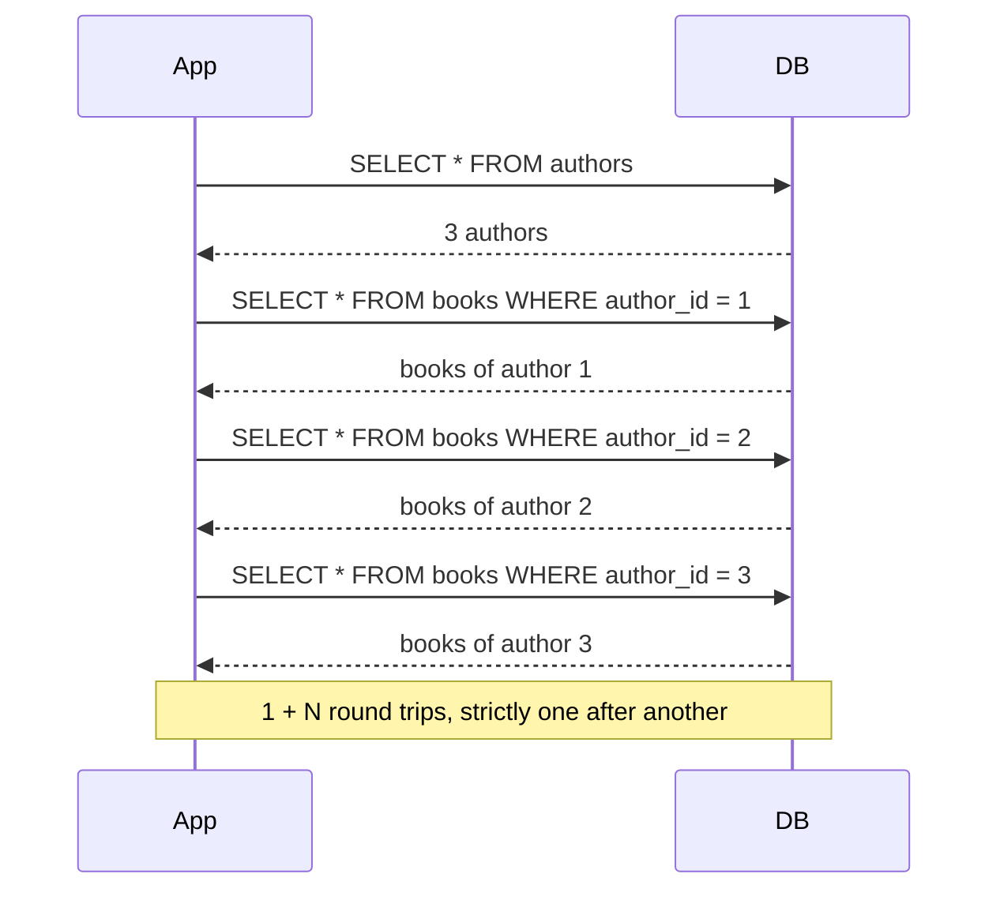
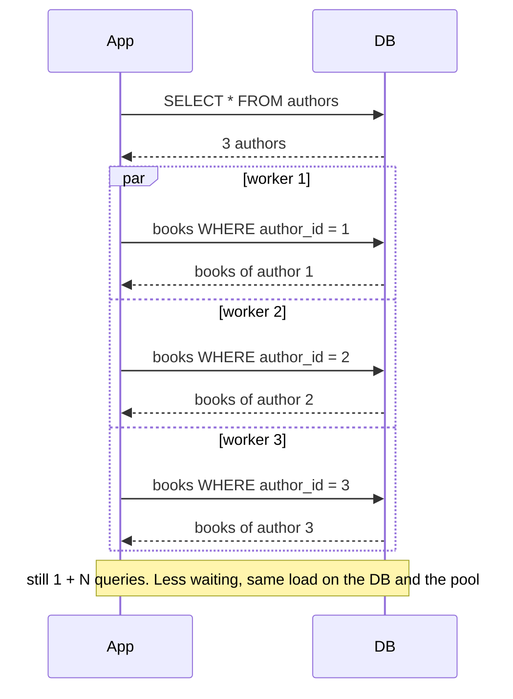
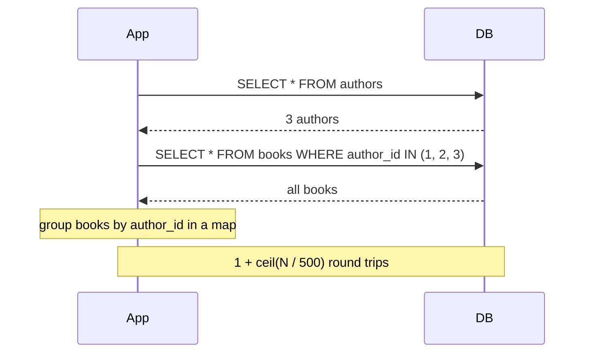
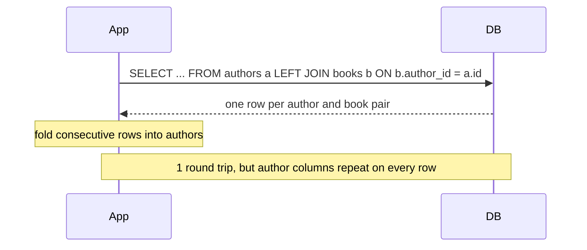
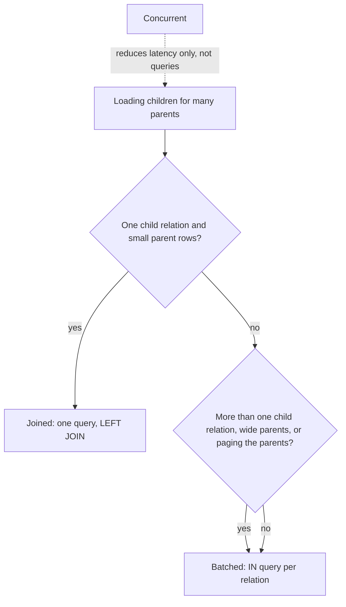

# N+1 queries in Go

Four ways to load authors with their books, compared on query count and time.
No external dependencies: the "database" is a fake that charges a fixed
round-trip latency per query, so results are reproducible and query counts are
exact.

```sh
go test ./nplusone                                     # equivalence, query counts, cancellation
go test ./nplusone -run xxx -bench . -benchtime=20x    # benchmarks
```

## Files

| File | What it is |
|---|---|
| `store.go` | Fake DB: one method = one round trip = one counted query |
| `loaders.go` | `Naive`, `Concurrent`, `Batched`, `Joined` |
| `loaders_test.go` | All variants return identical results; exact query counts; cancellation |
| `loaders_bench_test.go` | Time and `queries/op` as N grows; zero-latency control |

## How each variant talks to the database

Shown with 3 authors for brevity.

### Naive: N+1



### Concurrent: same queries, overlapped



### Batched: IN query, grouped in memory



### Joined: one query



### Choosing



## Results

Simulated 200µs round trip, 5 books per author, Intel Pentium G4400,
`-benchtime=20x`. Each cell is time / queries per op.

| Authors | naive | concurrent (8) | batched | joined |
|---:|---:|---:|---:|---:|
| 10 | 12.4 ms / 11 | 3.6 ms / 11 | 2.3 ms / 2 | 1.1 ms / 1 |
| 100 | 114 ms / 101 | 15.8 ms / 101 | 2.9 ms / 2 | 1.6 ms / 1 |
| 500 | 572 ms / 501 | 71.9 ms / 501 | 5.5 ms / 2 | 4.4 ms / 1 |

Control, zero latency, 500 authors: naive 0.27 ms, joined 0.55 ms, batched
1.0 ms, concurrent 1.5 ms. Batched and joined allocate about 520-620 KB/op
against 109 KB for naive, because they materialize and group everything in
memory.

Latency is simulated with timers, so absolute numbers are illustrative, not a
measurement of a real database. The shape (linear vs flat) is the point.
